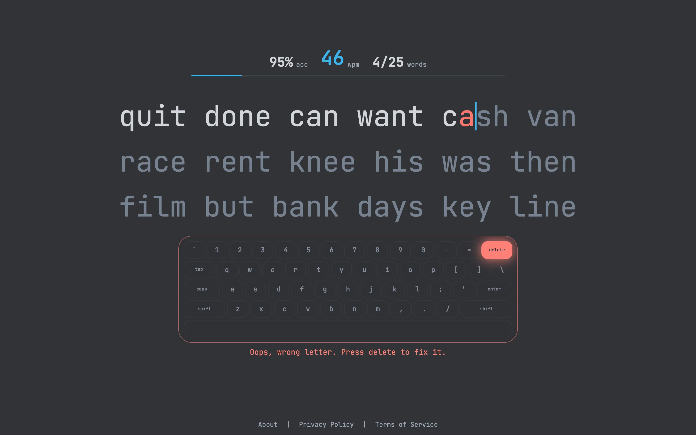
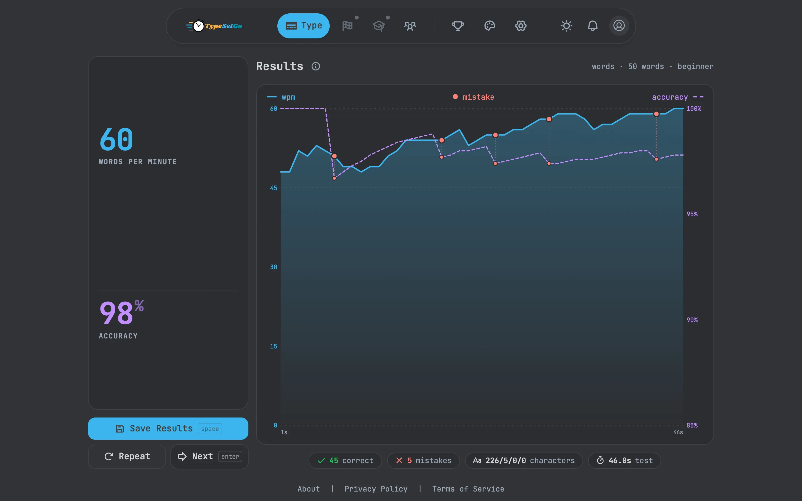
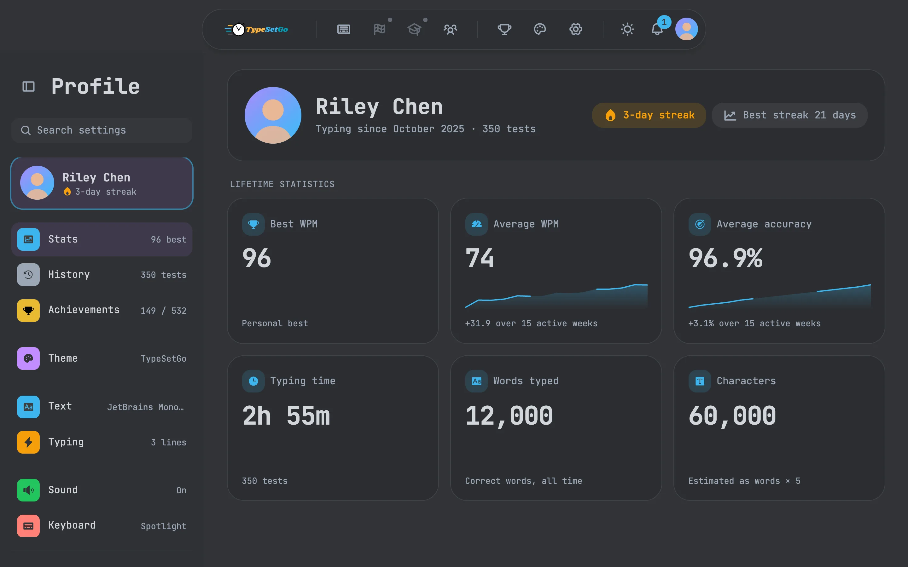
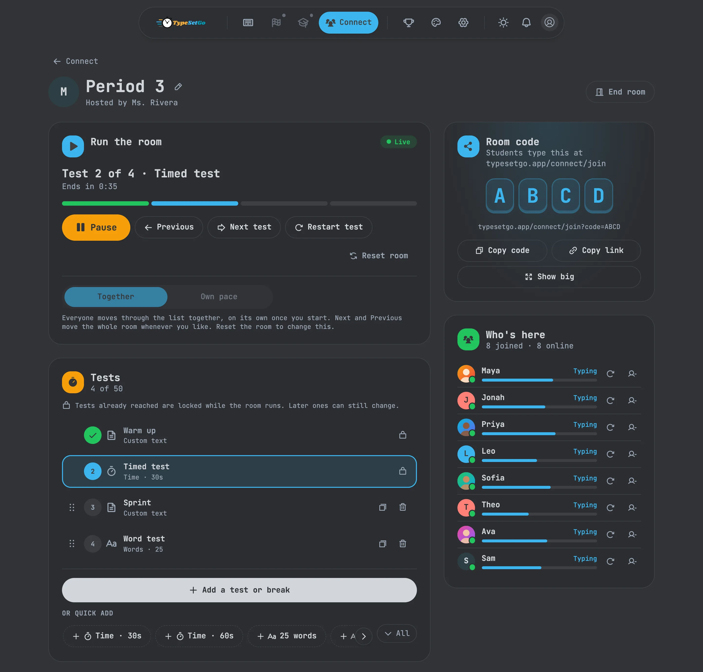
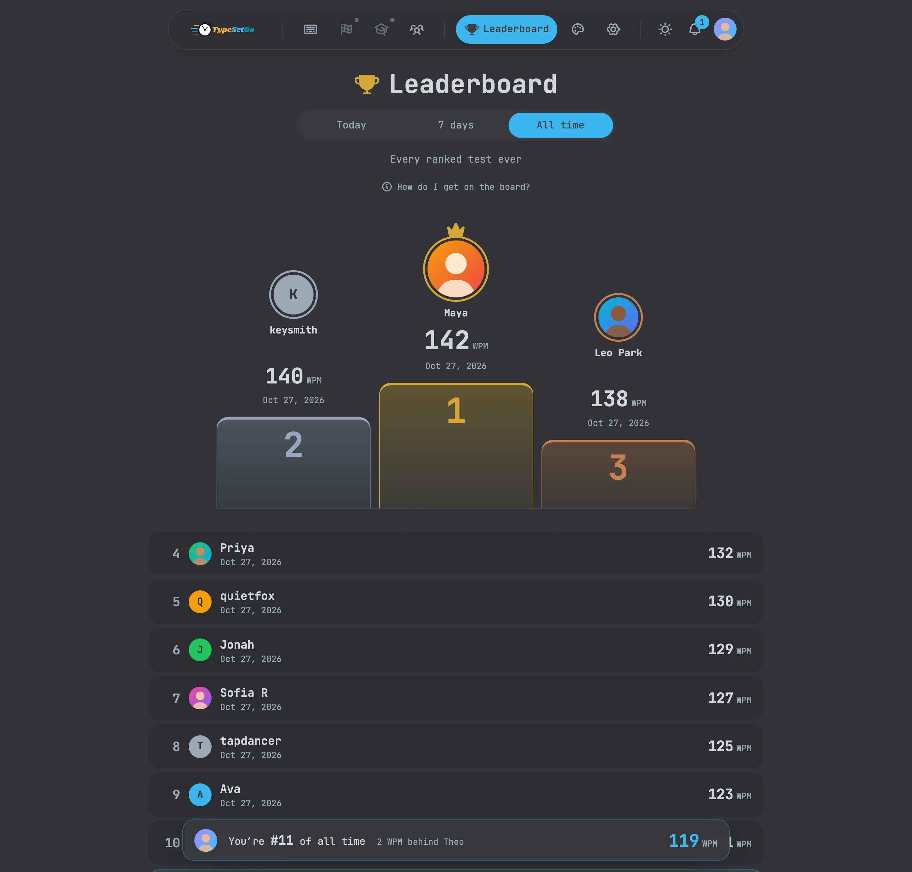
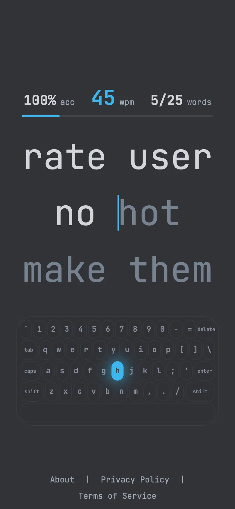
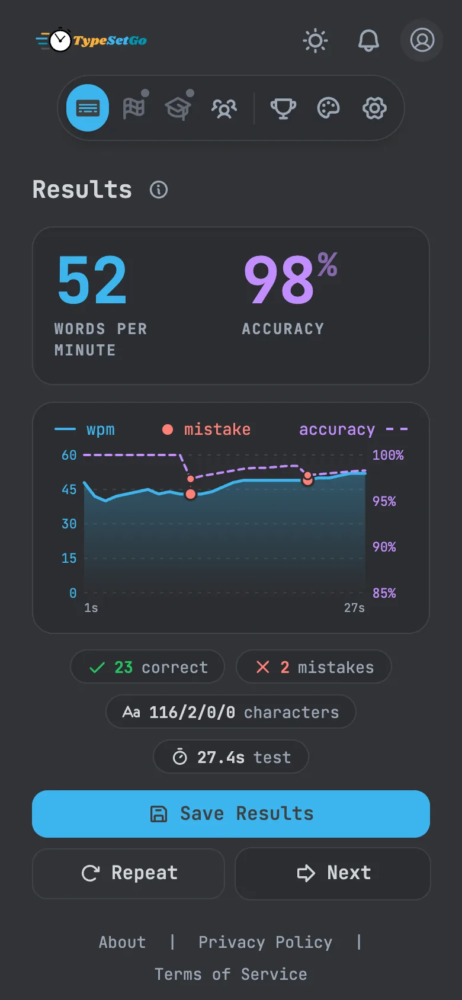

<p align="center">
  <picture>
    <source
      media="(prefers-color-scheme: dark)"
      srcset="public/assets/Banner-Color.png"
    />
    
  </picture>
</p>

<p align="center">
  <a href="https://github.com/dmeim/typesetgo"></a>
  <a href="https://github.com/dmeim/typesetgo"></a>
  <a href="src/"></a>
</p>

A modern, open-source typing practice platform with a clean, distraction-free interface. Multiple test modes, 2,600 theme looks, sound packs, classroom multiplayer, real-time statistics, and deep customization — all powered by a real-time **Convex** backend with optional **Clerk** authentication.

**What's new:** see the [changelog](https://typesetgo.app/changelog) for every change with screenshots and working demos you can try on the page.

## Highlights

- **Multiple modes** — Time, Words, Quotes (Short–XL), Zen, and Preset text
- **On-screen keyboards** — Spotlight by default, plus a colour-coded Finger guide, chunky Keycaps, or the classic look
- **One-screen results** — speed and accuracy on one graph with mistakes marked, compared with your average and best
- **2,600 theme looks** — 18 categories, light and dark versions, with live previews
- **72 typing fonts** — all served locally, including OpenDyslexic
- **Ghost Writer** — race a ghost cursor set to your target WPM
- **Connect for classrooms** — host a room, share a code, and watch a live board as everyone types
- **Profile page** — stats, a history timeline, achievements and every setting in one place
- **Leaderboard** — Today, 7 days and All time on one podium, with your own standing
- **Cloudflare-hosted** — frontend served by Workers Static Assets, with Clerk and Convex

## Screenshots

<table>
  <tr>
    <td width="40%" valign="top">
      <h3>Typing</h3>
      <p>A distraction-free typing view. Accuracy, speed and time roll by in one quiet line above a thin progress bar, and the Spotlight keyboard glides to the next key, lights the Shift to hold, and points at delete when a letter is wrong.</p>
    </td>
    <td width="60%">
      
    </td>
  </tr>
  <tr>
    <td width="40%" valign="top">
      <h3>Results</h3>
      <p>Everything fits on one screen: your speed and accuracy on the left, compared with your recent average and best, and a graph of both that fills the rest. Correct words, mistakes and characters open over the graph.</p>
    </td>
    <td width="60%">
      
    </td>
  </tr>
  <tr>
    <td width="40%" valign="top">
      <h3>Profile and settings</h3>
      <p>Your stats, history, achievements and every setting on one page: themes with live previews, fonts, typing options, sound, and the keyboard style.</p>
    </td>
    <td width="60%">
      
    </td>
  </tr>
  <tr>
    <td width="40%" valign="top">
      <h3>Connect</h3>
      <p>Host a room for a class: share a four-letter code, build the test list, give everyone the same theme and settings, and follow a live board of cards as students type. Students join with just the code.</p>
    </td>
    <td width="60%">
      
    </td>
  </tr>
  <tr>
    <td width="40%" valign="top">
      <h3>Leaderboard</h3>
      <p>Today, 7 days and All time on one podium, with ranks 4 to 50 below and a bar showing your own standing when you're signed in.</p>
    </td>
    <td width="60%">
      
    </td>
  </tr>
  <tr>
    <td width="40%" valign="top">
      <h3>On a phone</h3>
      <p>The header folds into two rows, the keyboard scales to the screen, and results stack into one column.</p>
    </td>
    <td width="60%">
      
      
    </td>
  </tr>
</table>

More screenshots, one per change, are in [`public/changelog/`](public/changelog/). They are captured from the local fixtures with `bun run shots:changelog`.

## Quick Start

### Hosting and deployment

Live app: **https://typesetgo.app**. Cloudflare Workers Static Assets serves the frontend; production Clerk handles sign-in, and the existing Convex **development deployment** holds the app's data.

The deployment record reports an owner-configured Workers Builds connection to GitHub `main`; its first successful automated deployment is not recorded. Remote settings were not rechecked during the September 2026 cleanup. Treat a push to `main` as potentially publishing the frontend. Manual deployment remains available.

For a manual deployment, first verify your Cloudflare account and ignored local build settings:

```bash
bun run build
bun run test:run
bun run cf:deploy
```

`cf:deploy` builds locally and uploads to the live Worker. See the [Cloudflare deployment guide](docs/deployment/CLOUDFLARE_GUIDE.md) for configuration, checks, and migration history. Docker/VPS deployment is retired.

### Development

**Prerequisites:** [Bun](https://bun.sh) v1.3.3+ and a [Convex](https://convex.dev) account (free tier available).

```bash
git clone https://github.com/dmeim/typesetgo.git
cd typesetgo
bun install
```

Start the isolated UI fixture without credentials or a backend:

```bash
bun run dev:fixture      # http://127.0.0.1:4317
```

This uses real UI with local fixture data. For real backend development, follow [development targets](docs/development.md). The existing cloud **development** deployment holds live data; ordinary `convex dev` writes to its selected deployment. `bun run convex:dev` now requires an explicit env file and expected target.

| Command | Description |
|---------|-------------|
| `bun run dev` | Start dev server |
| `bun run build` | Production build |
| `bun run test:run` | Run tests |
| `bun run lint` | Run ESLint with the supported parser API |
| `bun run test:e2e` | Run isolated browser acceptance, using installed Chrome |
| `bun run dev:fixture` | Start isolated UI with local fixture data |
| `bun run convex:dev --env-file PATH --expect local:NAME` | Watch an explicitly selected local backend |

### Browser acceptance without live services

```bash
VITE_CONVEX_URL=https://fixture.invalid VITE_CLERK_PUBLISHABLE_KEY= bun run build
bun run test:e2e                 # Practice, Fonts, Profiles, Host, real Join, Race
bun run test:e2e practice        # One suite during local iteration
bun run test:e2e fonts           # Font loading and built asset paths (requires build)
```

These checks require Node.js 22.12+ and installed Chrome. They run real UI components with local auth/data substitutes; no Clerk or Convex credentials are needed. They cover prompt/session transitions, dialogs and keyboard use, representative layouts/themes, owner/visitor profiles, and multiplayer lifecycle failures/recovery. See the [browser testing guide](tests/browser/README.md) for browser overrides, fixture boundaries, and artifacts.

All downloadable fonts are served locally. See the [font inventory and licenses](public/fonts/README.md) for sources, pinned versions, lazy loading behavior, and update instructions.

Builds retain native TypeScript 7 while lint uses the compatible TypeScript 6 API. Use the package scripts so each tool gets its intended compiler; the [tooling note](docs/ui-cleanup/tooling.md) explains the arrangement.

## Documentation

[Documentation index](docs/README.md) identifies current guides and historical plans. [Codebase improvements](docs/CODEBASE-IMPROVEMENTS-2026-09-23.md) is the current implementation checklist; the [previous review](docs/CODEBASE-REVIEW.md) records resolved findings.

- **[Tech Stack](docs/TECH-STACK.md)** — full technology inventory with versions and roles
- **[Cloudflare Deployment](docs/deployment/CLOUDFLARE_GUIDE.md)** — configured hosting and recorded deployment history
- **[Core Typing Engine](docs/features/Core_Typing_Engine.md)** — modes, statistics, and architecture
- **[Content Management](docs/features/Content_Management.md)** — word lists, quotes, and adding content
- **[Release Notes](docs/release-notes/)** — changelog and version history
- **[Product Roadmap](docs/TODO.md)** — planned features and progress

*More documentation is planned — theme customization, sound packs, settings reference, keyboard shortcuts, and contributor guides are on the list.*

---

<p align="center">
  <a href="docs/">Docs</a> ·
  <a href="docs/TODO.md">Roadmap</a>
</p>
